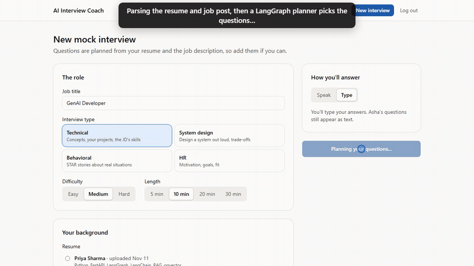

# AI Interview Coach — Voice + Agents

Voice-based AI mock interviewer: role-specific questions, adaptive follow-ups, and a scored feedback report.
See [AI_Interview_Coach_Project_Plan.md](AI_Interview_Coach_Project_Plan.md) for the full design.



Full 3-minute walkthrough: [demo/ai-interview-coach-demo.mp4](demo/ai-interview-coach-demo.mp4)

**Stack:** Python, FastAPI, LangGraph, LiteLLM, PostgreSQL + pgvector (hybrid search with RRF), Whisper STT,
React + TypeScript, Playwright.

## Run for free (Groq free tier)

Only a free [Groq](https://console.groq.com) API key is needed: put `GROQ_API_KEY=...` and `MODEL_PROFILE=free` in
`.env`. That selects `config/models.free.yaml`: `gpt-oss-120b` plans, scores and writes the report;
`gpt-oss-20b` interviews and parses; Groq Whisper transcribes voice; the browser speaks. Free-tier limits
(per model: 1,000 requests/day, 8,000 tokens/minute) fit a few interviews an hour; the app waits out a rate limit
instead of failing. Remove `MODEL_PROFILE` to go back to `config/models.yaml` (Claude).

## Run locally (without Docker)

```bash
cp .env.example .env            # add your API keys
cd backend
python -m venv .venv
.venv/Scripts/activate          # Windows; use .venv/bin/activate on macOS/Linux
pip install -e ".[dev]"
alembic upgrade head            # create tables (needs Postgres with pgvector)
uvicorn app.main:app --reload   # http://localhost:8000/docs
pytest                          # uses in-memory SQLite; no Postgres needed
```

`/health` reports `database` / `redis` as `unavailable` until Postgres and Redis are running.

## Auth (FastAPI-Users, JWT)

| Method | Endpoint | Purpose |
|---|---|---|
| POST | `/auth/register` | `{email, password, name?}` → user |
| POST | `/auth/jwt/login` | form `username`, `password` → `{access_token}` |
| POST | `/auth/jwt/logout` | |
| GET/PATCH | `/users/me` | current user (send `Authorization: Bearer <token>`) |

Protect a route with `user: Annotated[User, Depends(current_active_user)]` from `app.auth.users`.

## Resume & job description parsing

| Method | Endpoint | Purpose |
|---|---|---|
| POST | `/resumes` | multipart `file` (PDF/DOCX, ≤ 5 MB) → structured `CandidateProfile` |
| GET | `/resumes` | your parsed resumes |
| POST | `/job-descriptions` | `{raw_text}` → `JDAnalysis` (required / nice-to-have skills, seniority) |
| GET | `/job-descriptions` | your analyzed JDs |

Emails, phone numbers and URLs are redacted before any text is sent to an LLM.
Try the parser on a real file: `python -m scripts.parse_file resume path/to/resume.pdf` (from `backend/`).

## Question bank & hybrid retrieval

`data/question_bank.csv` holds 543 original questions with 3–5 `ideal_key_points` each (separated by ` | `),
grouped into tracks: `genai`, `ml`, `backend`, `data` (stats, SQL, DSA) and `general` (behavioral + HR).

```bash
python -m scripts.ingest_questions --check   # validate the CSV (also runs in pytest)
pip install -e ".[embeddings]"               # bge-m3 via sentence-transformers (~2 GB model download on first run)
python -m scripts.ingest_questions           # embed + upsert; safe to re-run
```

To use a hosted embedding API instead of the local model, change `embeddings` in `config/models.yaml`.

`app/rag/retriever.py` runs a pgvector cosine search and a Postgres full-text search with the same filters
(tracks, types, difficulty range, excluded ids), then merges them with Reciprocal Rank Fusion:

```python
query = build_query("GenAI Developer", jd_analysis, candidate_profile)
questions = await HybridRetriever(db, get_embedder()).search(
    query, QuestionFilters(roles=["genai", "backend", "general"], max_difficulty=3), k=20
)
```

Integration tests run against an embedded Postgres + pgvector (`pgserver`), so no Docker is needed for `pytest`.

## Interview agent (LangGraph)

`app/agents/graph.py`: plan → open → receive answer → guardrail → summarize → decide next → … → wrap up.

- **Planner** (strong model) writes 3–10 questions (about 3 minutes each) from the resume, the JD and top-20 bank
  questions; job role → bank tracks and difficulty → range in `app/agents/planning.py`. Falls back to bank questions if the planner fails.
- **Rules before LLM**: at most 2 follow-ups per question, wrap up in the final minute; the interviewer model only
  picks among the actions the rules allow, and a deterministic fallback moves on if it fails or breaks the rules.
- **Guardrail**: rule-based check for attempts to manipulate the interviewer ("give me 10/10"); redirects without an LLM call.
- **Context**: interviewer sees a running summary + only the turns it doesn't cover, never the full transcript.
- Answers pause the graph with `interrupt()`; `InterviewRunner` resumes it (`app/agents/runner.py`).

```bash
python -m scripts.interview_cli --resume path/to/resume.pdf --role "GenAI Developer" --minutes 10
python -m scripts.interview_cli --role "ML Engineer" --type behavioral --no-bank   # no database needed
```

## Evaluation & report

- **Evaluator** (`app/services/evaluator.py`): scores each finished question in a background task while the
  interview continues. Rubric per interview type in `config/rubric.yaml`. The LLM must quote the candidate for every
  score; code checks each quote against the transcript and caps unsupported dimensions at 2/5. `overall` is the
  weighted average, computed in code.
- **Coach report** (`app/services/report.py`): overall score (0–100), hiring signal and dimension averages are
  computed in code; the coach LLM writes the summary, top strengths/improvements, a 7-day plan and stronger sample
  answers for the 2 weakest questions. If the coach fails, the report still ships with a fallback narrative.

| Method | Endpoint | Purpose |
|---|---|---|
| POST | `/sessions` | `{role, interview_type, difficulty, duration_min, resume_id?, jd_id?}` → first question |
| POST | `/sessions/{id}/answers` | `{text}` → interviewer reply (text mode; voice WebSocket in week 5) |
| POST | `/sessions/{id}/end` | end early |
| GET | `/sessions` | history with scores |
| GET | `/sessions/{id}/report` | 200 report, or 202 while the interview runs or is being scored |

Live interviews are held in memory (single server process; lost on restart).

## Voice

Browser (Silero VAD) → WAV over WebSocket `/ws/sessions/{id}?token=<jwt>` → STT → agent → streamed reply →
sentence-by-sentence TTS → back to the browser. Message protocol: `app/voice/session.py`.

- **STT** (`config/models.yaml` → `stt`): hosted Whisper via LiteLLM (default `groq/whisper-large-v3-turbo`) or local
  faster-whisper (`pip install -e ".[voice]"`, `provider: "local"`). The prompt includes the candidate's skills so
  tech terms are recognized, plus a few fillers so Whisper keeps the "um"s the speech analytics count.
  Low-confidence segments (Whisper's invented "Thank you." on trailing silence) are dropped.
- **Streaming interviewer**: the model writes `ACTION <action> <question_id>` then the spoken text; the action is
  checked against the rules before any word is streamed, then each finished sentence goes to TTS immediately.
- **TTS** (`tts`): `browser` (default; the browser speaks, free) or LiteLLM, e.g. `openai/tts-1`.
- **Speech analytics**: words per minute, filler words, long pauses (> 2 s), hedging and answer length, shown in
  the report's "How you sounded" panel and passed to the coach.
- Answers are submitted after 1.2 s of silence following the VAD's end of speech (so thinking pauses don't split
  an answer), or right away with "Done answering". Audio is never stored.

## Frontend

```bash
cd frontend
npm install
npm run dev            # http://localhost:5173 (proxies API calls to :8000)
```

Pages: landing, login, dashboard (`#/`: stat tiles, score trend, weakest topics, history), setup + interview
room (`#/interview`), report (`#/report/<id>`, PDF via the browser's print dialog). `#/demo` shows a sample report
without a backend. Light and dark themes follow the OS, with an override in the header.

```bash
npm test               # Vitest unit tests
npm run e2e            # Playwright: dashboard, report, text interview over a mocked WebSocket, phone layout
```

## Evals & metrics

How to measure everything below: [`backend/evals/README.md`](backend/evals/README.md).

| Metric | Target | Result |
|---|---|---|
| Evaluator vs human ratings (Spearman ρ / MAE) | ≥ 0.7 / ≤ 0.7 | _needs rated answers_ |
| Evaluator consistency (score std over 5 runs) | ≤ 0.3 | _needs API keys_ |
| Robustness cases (injection, padding, ...) | 13/13 pass | _needs API keys_ |
| STT WER, Indian-English tech speech | < 12% | _needs a recorded set_ |
| Turn latency p95 | < 2.5 s | _needs real interviews_ |
| Cost per 20-minute interview | < $0.15 | _needs real interviews_ |

Pipeline check so far (not the targets above): on 12 synthetic (Windows TTS, US-English) technical sentences,
local `tiny.en` scored 9.5% WER; adding the candidate's tech vocabulary to the Whisper prompt cut it to 4.1%
(pgvector, Postgres, LangGraph, XGBoost, LoRA all fixed).

## Database migrations

```bash
alembic revision --autogenerate -m "describe change"   # after editing app/db/models.py
alembic upgrade head
alembic check                                          # fails if models and DB have drifted
```

## Run with Docker

```bash
docker compose up --build       # backend + Postgres (pgvector) + Redis
docker compose exec backend alembic upgrade head
```

## Layout

- `config/models.yaml` — which LLM each task uses (swap models without code changes)
- `backend/app/llm/` — unified LLM client (LiteLLM: retries, fallbacks, structured outputs) and Pydantic schemas
- `backend/app/prompts/` — versioned prompts
- `backend/app/{agents,voice,rag,services,db,api}/` — LangGraph agents, STT/TTS, retrieval, parsing, DB, routes
