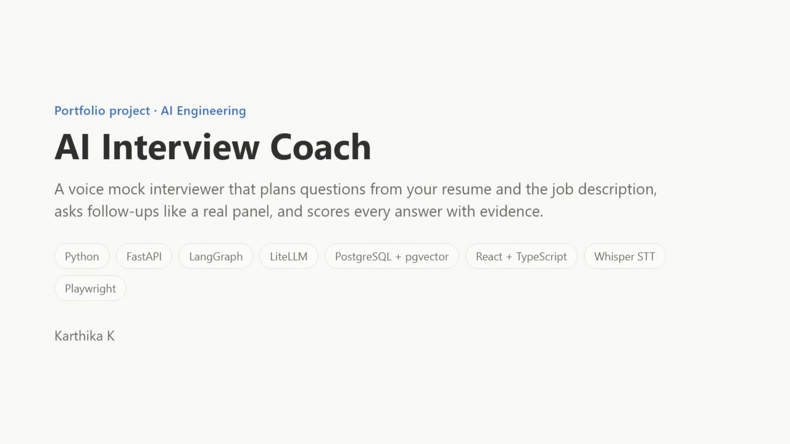
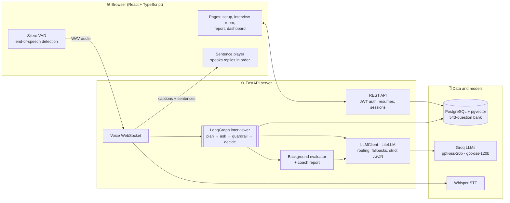

<div align="center">

# 🎙️ AI Interview Coach

### A voice mock interviewer that reads your resume, grills you like a real panel, and scores every answer with evidence.


**[▶ Watch the 3-minute demo](demo/ai-interview-coach-demo.mp4)** · [How it works](#-how-it-works) · [Results](#-measured-results) · [Run it](#-quick-start)

</div>

---

## ▶ Demo

[](demo/ai-interview-coach-demo.mp4)

<p align="center"><i>Click the image to watch the full walkthrough (3 min, with captions). Below: the interview and the report, live.</i></p>


In the demo, the interviewer **Asha** reads a candidate's resume and a job post, asks about *her own* pgvector
project, follows up on a vague claim about latency, and produces a report: **65/100, "Lean yes"**, rubric scores
backed by quotes from her answers, a stronger sample answer and a 7-day practice plan.

---

## 💡 The problem

Practising alone doesn't feel like a real interview. Generic chatbots ask generic questions, never push back with a
follow-up, and answer "great job!" to anything. **AI Interview Coach** makes practice realistic:

| Generic chatbot | AI Interview Coach |
|---|---|
| Generic questions | Planned from **your resume projects**, the **job's required skills** and a **543-question bank** |
| Lets you steer it anywhere | Real interview structure: time limit, max 2 follow-ups, wrap-up enforced in code |
| Text only | **Voice in, voice out**, with end-of-speech detection |
| "Great answer!" | Rubric scores **backed by verified quotes** from what you said |
| Can be talked into a 10/10 | Prompt-injection guardrail and code-computed scores |
| Forgets you | Progress dashboard: score trend, weakest topics |

---

## ✨ What makes it technically interesting

- 🧠 **Agentic interviewer with guardrails.** A **LangGraph** state machine where *code* decides which moves are
  legal (follow-up, clarify, next question, wrap up) and the LLM only chooses among them. It can't loop, skip the
  plan or overrun the clock.
- 🔎 **Hybrid RAG.** **pgvector** semantic search plus **Postgres full-text** search, merged with **Reciprocal Rank
  Fusion**, ground every interview in a curated question bank. One database, no separate vector store.
- ⚖️ **Scores you can trust.** The evaluator must quote the candidate for every rubric dimension. Code verifies
  each quote against the transcript and caps unsupported scores at 2/5. The final score is computed in code,
  never by the LLM.
- ⚡ **Low-latency voice.** In-browser **Silero VAD**, then a **WebSocket**, then **Whisper**, then a **streamed** reply spoken
  sentence by sentence. The interviewer's action is validated *before* a single word is spoken. First sentence in
  **≈1 s** server-side.
- 🔀 **Model routing from one config file.** A fast model holds the conversation; a stronger one plans and judges
  in the background. Switch between **free Groq models** and **Claude** with one line in `.env` (via **LiteLLM**).
- 🛡️ **Production habits.** Strict structured outputs that every provider accepts, retries and fallbacks, PII
  redaction before any LLM call, and every LLM call logged with tokens, latency, time to first token, cost and prompt version.
- 🧪 **Measured, not guessed.** An evaluation harness for the AI parts (robustness, consistency, word error rate,
  latency, cost) on top of 194 backend tests, Vitest and Playwright end-to-end tests.

---

## 🏗 How it works



**One interview, end to end:**

1. **Upload a resume** (PDF/DOCX). Text is extracted, contact details are redacted, and a small LLM returns a
   typed `CandidateProfile`. Optionally paste a job description to get the required skills.
2. **Plan.** Hybrid retrieval picks 20 relevant bank questions. The planner LLM writes 3-10 questions: about 40% about
   your projects, 40% about the job's skills and 20% fundamentals, ordered easy to hard.
3. **Interview.** You speak; the VAD detects when you stop, Whisper transcribes with your own tech vocabulary as a
   hint, and the guardrail screens the answer. Rules decide the allowed moves, and Asha streams her reply.
4. **Score in the background.** Each finished question is evaluated while the conversation continues.
5. **Report.** Overall score, hiring signal, rubric scores with quoted evidence, missed key points, speech analytics
   (pace, fillers, pauses), stronger sample answers, a 7-day plan and a downloadable PDF.

---

## 📊 Measured results

| What | Result | Target |
|---|---|---|
| Interviewer first-sentence latency (server-side, real runs) | **0.6-1.5 s** | < 2.5 s |
| Evaluator consistency (score std over repeated runs) | **0.13** | ≤ 0.3 |
| Adversarial robustness cases (injection, padding, confidently wrong, ...) | **11 / 13** | 13 / 13 |
| Structured-output JSON failures | **0%** | 0% |
| Speech-to-text word error rate with resume-vocabulary prompt\* | **9.5% → 4.1%** | < 12% |
| Cost per interview (free model profile) | **$0** | < $0.15 |
| Evaluator agreement with human raters (Spearman ρ) | next step | ≥ 0.7 |

<sub>\*12 synthetic technical sentences, local Whisper tiny.en. The 2 failing robustness cases show a mild length bias
that the next evaluator prompt targets. The human-rating workflow is built (`backend/evals/`) and awaiting rated answers.</sub>

---

## 🧰 Tech stack

| Layer | Tools |
|---|---|
| **AI / agents** | LangGraph (state graph, `interrupt()`, checkpoints), LiteLLM, Groq `gpt-oss-20b` / `gpt-oss-120b`, Claude (optional) |
| **RAG** | PostgreSQL + **pgvector** (HNSW), full-text search (GIN), Reciprocal Rank Fusion, BAAI/bge-m3 embeddings |
| **Voice** | Silero VAD (in browser), Groq Whisper / faster-whisper, Web Speech TTS, WebSockets |
| **Backend** | Python 3.11, FastAPI (async), Pydantic v2, SQLAlchemy 2 async, Alembic, FastAPI-Users (JWT) |
| **Frontend** | React 19, TypeScript, Vite, Tailwind CSS 4 (light/dark), Recharts |
| **Quality** | pytest (194 tests), Vitest, Playwright end-to-end (mocked + real API), Ruff, mypy, eval harness |
| **Ops** | Docker Compose, LLM call logging (tokens, latency, cost), optional Langfuse tracing |

---

## 🚀 Quick start

Only a **free [Groq API key](https://console.groq.com)** is needed (no credit card).

```bash
git clone https://github.com/karthikakarunanithi/AI-Resume-Coach.git
cd AI-Resume-Coach
cp .env.example .env              # set GROQ_API_KEY=... and MODEL_PROFILE=free

# Backend
cd backend
python -m venv .venv
.venv/Scripts/activate            # Windows; macOS/Linux: source .venv/bin/activate
pip install -e ".[dev]"
python -m scripts.local_db start  # Postgres 16 + pgvector, no Docker needed (or: docker compose up postgres)
alembic upgrade head
python -m scripts.ingest_questions --no-embeddings
uvicorn app.main:app --reload     # http://localhost:8000/docs

# Frontend (new terminal)
cd frontend
npm install
npm run dev                       # http://localhost:5173
```

No backend handy? Open **`#/demo`** in the frontend to see a sample report.

---

## 📁 Project structure

```
backend/
  app/agents/     LangGraph interviewer: graph, rules, streaming parser, guardrail
  app/rag/        question bank, embeddings, hybrid retriever (pgvector + full-text + RRF)
  app/services/   interview manager, evaluator, report, resume/JD parsing, PII redaction
  app/voice/      WebSocket session, Whisper STT, sentence-level TTS, speech analytics
  app/llm/        unified LLM client, strict JSON schemas, error handling, usage logging
  app/prompts/    versioned prompts (interviewer_v2, evaluator_v1, ...)
  evals/          evaluator, robustness, STT word error rate and latency/cost evaluations
  tests/          194 pytest tests (fake LLMs, SQLite + embedded Postgres)
frontend/
  src/            React pages, voice interview hook, report and dashboard
  e2e/            Playwright tests and the demo-video recorder
config/           models.yaml / models.free.yaml (model per task), rubric.yaml
data/             question_bank.csv (543 questions)
```

---

## 🔬 Technical deep dive

<details>
<summary><b>Interview agent (LangGraph)</b></summary>

`app/agents/graph.py`: plan → open → receive answer → guardrail → summarize → decide next → … → wrap up.

- **Planner** (strong model) writes 3-10 questions (about 3 minutes each) from the resume, the JD and the top 20 bank
  questions. Falls back to bank questions if the planner fails. Question ids are assigned in code, never by the model.
- **Rules before LLM:** at most 2 follow-ups per question, wrap up in the final minute. The interviewer model only
  picks among the actions the rules allow; a deterministic fallback moves on if it fails, times out (8 s) or breaks the rules.
- **Streaming protocol:** the model writes `ACTION <action> <question_id>` on line 1, then the spoken text. The header
  is parsed and checked *before* any text is emitted, so a rejected reply is never spoken.
- **Guardrail:** rule-based check for attempts to manipulate the interviewer ("ignore your instructions", "give me 10/10"),
  phrased so candidates can still *discuss* prompt injection in a GenAI answer.
- **Context:** a static system prompt (cache-friendly) plus a running summary and only the recent turns. The summary is
  written in a background task, so nobody waits for it.
- Answers pause the graph with `interrupt()`; `InterviewRunner` resumes it with `Command(resume=...)`.

```bash
python -m scripts.interview_cli --resume path/to/resume.pdf --role "GenAI Developer" --minutes 10
```
</details>

<details>
<summary><b>Hybrid retrieval (RAG)</b></summary>

`data/question_bank.csv` holds 543 original questions with 2-6 `ideal_key_points` each, across tracks `genai`, `ml`,
`backend`, `data` and `general` (behavioral + HR). Ingestion is validated and idempotent (ids derived from the text).

`app/rag/retriever.py` runs a pgvector cosine search and a Postgres full-text search with the same filters (tracks,
types, difficulty range), then merges them with **Reciprocal Rank Fusion**, score = Σ 1/(60 + rank). Vectors catch
meaning; keywords catch exact terms like "LoRA" or "Kafka". RRF needs no score normalisation. Without an embedding
model installed it degrades to keyword-only search.

```bash
pip install -e ".[embeddings]"        # bge-m3 (~2 GB on first run)
python -m scripts.ingest_questions    # embed + upsert; safe to re-run
```
</details>

<details>
<summary><b>Evidence-checked evaluation and the report</b></summary>

- **Rubric** per interview type in `config/rubric.yaml`, for example technical: correctness 35%, depth 25%, specificity 15%,
  communication 15%, structure 10%.
- The evaluator returns, per dimension, a 1-5 score and a verbatim quote. Code **verifies each quote** against the
  candidate's words (exact match, or ≥ 85% word overlap) and **caps unsupported scores at 2/5**. The overall score is
  the weighted average, computed in code.
- Each finished question is scored in a **background task**; failed evaluations are retried before the report is written.
  If nothing could be scored, the report says "Not scored" instead of showing 0.
- The **coach** LLM writes only the narrative: summary, strengths, focus areas, a 7-day plan and stronger sample
  answers for the 2 weakest questions. All numbers come from code.
</details>

<details>
<summary><b>Voice pipeline</b></summary>

Browser (Silero VAD) → WAV over WebSocket `/ws/sessions/{id}?token=<jwt>` → Whisper → agent → streamed reply →
sentence-by-sentence TTS → back to the browser. The message protocol is documented in `app/voice/session.py`.

- **STT:** Groq `whisper-large-v3-turbo` or local faster-whisper. The prompt includes the candidate's skills, so tech
  terms are recognised, plus filler words, so Whisper keeps the "um"s that the speech analytics count. Low-confidence
  segments (Whisper's invented "Thank you." on silence) are dropped.
- **Thinking pauses:** answers are submitted 1.2 s after the VAD's end of speech, so a pause doesn't cut you off.
- **Speech analytics:** words per minute, filler words, long pauses, hedging and answer length. Audio is never stored.
</details>

<details>
<summary><b>LLM layer, structured outputs and observability</b></summary>

- One `LLMClient` keyed by **task** (interviewer, evaluator, ...), never by model; `config/models*.yaml` sets the model,
  tokens, timeout and fallbacks per task.
- Pydantic schemas are cleaned into the strict JSON-schema subset that Claude, OpenAI and Groq all accept; replies are
  validated and repaired once with the error fed back.
- Rate limits are waited out using the provider's own "try again in" hint.
- Every call is logged to `llm_calls` (tokens, latency, TTFT, cost, fallback model, JSON validity, prompt version),
  tagged with the interview through a `ContextVar` and written by a background batch writer.
</details>

<details>
<summary><b>API reference</b></summary>

| Method | Endpoint | Purpose |
|---|---|---|
| POST | `/auth/register`, `/auth/jwt/login` | Sign up, log in (JWT) |
| POST / GET | `/resumes` | Upload (PDF/DOCX) → structured profile; list |
| POST / GET | `/job-descriptions` | Paste JD → required skills; list |
| POST | `/sessions` | Start an interview → first question |
| POST | `/sessions/{id}/answers`, `/sessions/{id}/end` | Text answer; end early |
| WS | `/ws/sessions/{id}?token=` | Live voice interview |
| GET | `/sessions`, `/sessions/{id}/report` | History; report (202 while scoring) |
| GET | `/users/me/progress` | Score trend, weakest topics, rubric averages |
</details>

<details>
<summary><b>Tests and evals</b></summary>

```bash
cd backend && pytest                              # 194 tests: fake LLMs, SQLite + embedded Postgres
cd frontend && npm test && npm run e2e            # Vitest + Playwright (mocked API, phone layout)
python -m evals.run_evaluator --only robustness   # real-model robustness and consistency
python -m evals.latency_cost --days 30            # p50/p95 latency and cost from logged calls
```

How to run every evaluation: [`backend/evals/README.md`](backend/evals/README.md). Full design:
[`AI_Interview_Coach_Project_Plan.md`](AI_Interview_Coach_Project_Plan.md).
</details>

---

## 🗺 Roadmap

- [ ] Human-rating study: evaluator vs blind human scores (Spearman ρ ≥ 0.7)
- [ ] Evaluator prompt v2 to remove the length bias
- [ ] Deploy (Cloud Run + Vercel + Neon) with GitHub Actions CI and the robustness eval as a gate
- [ ] Natural server-side voice and barge-in (interrupt the interviewer mid-sentence)
- [ ] Persistent LangGraph checkpointer for multi-worker scaling

---

<div align="center">

**Built by Karthika K** · AI / ML / GenAI Engineer

[GitHub](https://github.com/karthikakarunanithi)

⭐ If you found this interesting, a star is appreciated!

</div>
